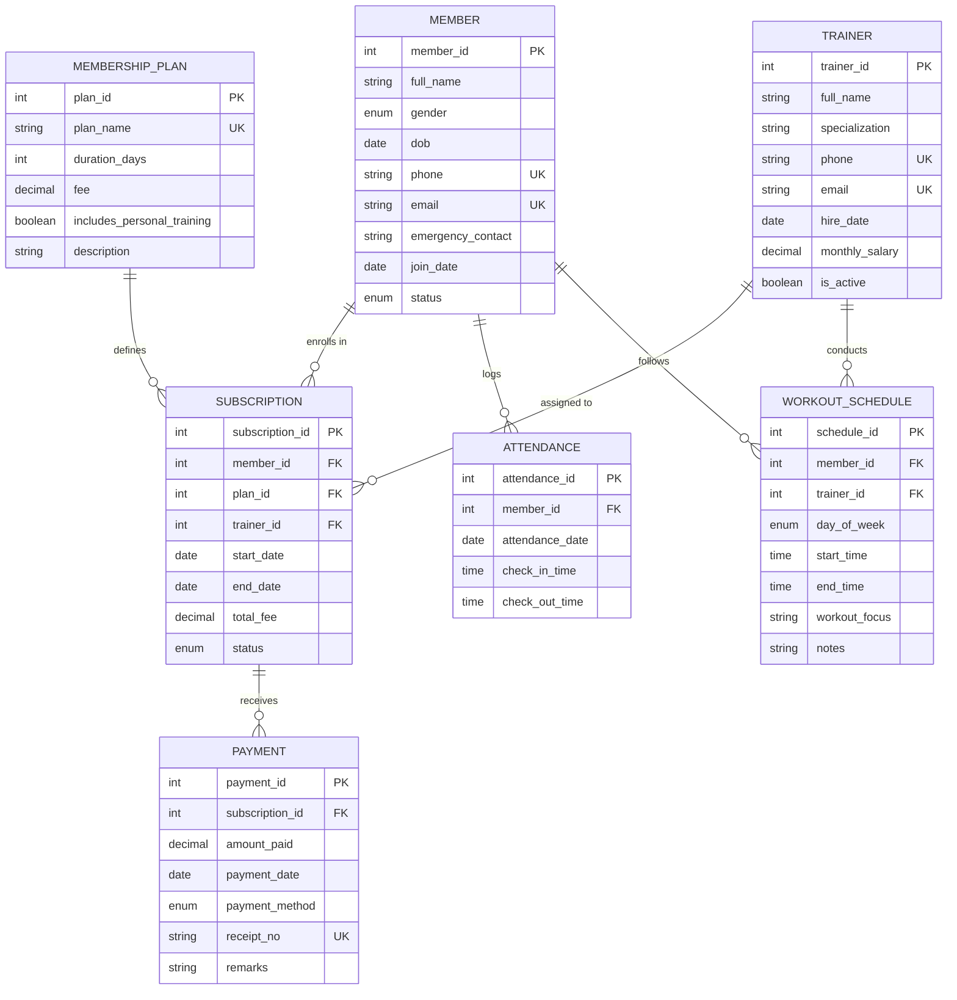

# Project Report: Smart Fitness Centre and Membership Management System

## 1. Problem Statement
Develop a **Smart Fitness Centre and Membership Management System** for a gym to manage **members, trainers, membership plans, attendance, workout schedules, and fee payments**. The system tracks **membership validity and pending dues**, **assigns trainers to members**, and generates **attendance reports, payment receipts, and renewal reminders**.

---

## 2. System Objectives & Features
1. **Member & Trainer Management:** Store profiles, contact details, specializations, and active status.
2. **Flexible Membership Plans & Subscriptions:** Track start/end dates, auto-calculate expiry dates, and preserve historical fee snapshots (`total_fee`).
3. **Installment Payments & Overpayment Protection:** Allow partial or full payments while automatically blocking payments that exceed the subscription fee.
4. **Smart Attendance Validation:** Automatically prevent gym check-ins if a member has no active subscription covering that date.
5. **Trainer Assignment & Workout Schedules:** Assign personal trainers via `Subscription` and manage weekly conflict-free workout slots.
6. **Automated Reports & Views:**
   * Pending dues report (`v_member_dues`)
   * Renewal reminders for plans expiring within 7 days (`v_renewal_reminders`)
   * Itemized payment receipts (`sp_payment_receipt`)
   * Attendance summary, trainer workload, and plan revenue analytics

---

## 3. Entity-Relationship (ER) Diagram

### Cardinality Summary
* **Member to Subscription (`1 : N`):** A member can renew or hold multiple subscriptions over time; each subscription belongs to one member.
* **Membership_Plan to Subscription (`1 : N`):** One plan template can be purchased in many subscriptions.
* **Trainer to Subscription (`1 : N`, optional):** A trainer can mentor many member subscriptions; `trainer_id` is nullable for basic plans without a personal trainer.
* **Subscription to Payment (`1 : N`):** A subscription can be paid in one lump sum or multiple installments.
* **Member to Attendance (`1 : N`):** Each member logs multiple daily attendance records (at most one per date via `UNIQUE (member_id, attendance_date)`).
* **Member & Trainer to Workout_Schedule (`1 : N` each):** Acts as a scheduled relationship between members and trainers by `day_of_week` and `start_time`.

---

## 4. Relational Schema & Keys

| Table | Primary Key | Foreign Keys | Key Constraints |
| :--- | :--- | :--- | :--- |
| `Member` | `member_id` | — | `UNIQUE(phone)`, `UNIQUE(email)` |
| `Trainer` | `trainer_id` | — | `UNIQUE(phone)`, `UNIQUE(email)`, `CHECK(monthly_salary > 0)` |
| `Membership_Plan` | `plan_id` | — | `UNIQUE(plan_name)`, `CHECK(duration_days > 0)`, `CHECK(fee > 0)` |
| `Subscription` | `subscription_id` | `member_id`, `plan_id`, `trainer_id` | `CHECK(end_date >= start_date)`, `CHECK(total_fee > 0)` |
| `Payment` | `payment_id` | `subscription_id` | `UNIQUE(receipt_no)`, `CHECK(amount_paid > 0)` |
| `Workout_Schedule` | `schedule_id` | `member_id`, `trainer_id` | `CHECK(end_time > start_time)`, `UNIQUE(member_id, day_of_week, start_time)` |
| `Attendance` | `attendance_id` | `member_id` | `CHECK(check_out_time >= check_in_time)`, `UNIQUE(member_id, attendance_date)` |

---

## 5. Normalization Proof (1NF → 2NF → 3NF → BCNF)

Imagine starting with a single unnormalized table:
`Gym_Record(member_id, member_name, phone, plan_name, plan_fee, trainer_name, payment_amounts, attendance_dates)`

1. **First Normal Form (1NF):**
   * *Problem:* `payment_amounts` and `attendance_dates` are multi-valued attributes.
   * *Fix:* Split repeating groups into separate rows/tables so every cell is atomic and every table has a primary key.
2. **Second Normal Form (2NF):**
   * *Problem:* In a combined `(member_id, plan_id, payment_id)` table, `member_name` depends only on `member_id` and `plan_fee` depends only on `plan_id` (partial dependencies).
   * *Fix:* Move member attributes to `Member`, plan attributes to `Membership_Plan`, and trainer attributes to `Trainer`, leaving single-column surrogate PKs (`subscription_id`, `payment_id`, `schedule_id`, `attendance_id`) so no partial dependencies exist.
3. **Third Normal Form (3NF):**
   * *Problem:* Storing `trainer_specialization` inside `Subscription` would create a transitive dependency (`subscription_id → trainer_id → trainer_specialization`). Similarly, storing derived `pending_due` as a column creates an update anomaly.
   * *Fix:* Keep `trainer_specialization` only in `Trainer`, and compute `pending_due` dynamically in the `v_member_dues` view (`total_fee - SUM(amount_paid)`).
   * *Note on `Subscription.total_fee`:* Unlike `Membership_Plan.fee` (current catalog price), `Subscription.total_fee` is the **agreed price at the time of purchase** (historical snapshot), so updating catalog prices later never corrupts past invoices.
4. **Boyce-Codd Normal Form (BCNF):**
   * Every determinant in all 7 tables is a candidate key (either the surrogate `*_id` PK or `UNIQUE` candidate keys like `phone`, `email`, `plan_name`, `receipt_no`, `(member_id, attendance_date)`). Therefore, all tables satisfy **BCNF**.

---

## 6. Database Automation (Triggers, Views & Procedures)

| Object | Type | Purpose |
| :--- | :--- | :--- |
| `trg_subscription_before_insert` | Trigger (`BEFORE INSERT`) | Auto-calculates `end_date` from `duration_days` and populates `total_fee` from `Membership_Plan` if omitted. |
| `trg_payment_before_insert` | Trigger (`BEFORE INSERT`) | Blocks overpayment (`total_paid + new_payment > total_fee`). |
| `trg_attendance_before_insert` | Trigger (`BEFORE INSERT`) | Blocks gym check-in if the member does not have an `Active` subscription covering `attendance_date`. |
| `v_member_dues` | View | Shows `total_fee`, `amount_paid`, and `pending_due` per subscription. |
| `v_renewal_reminders` | View | Lists subscriptions expiring within 7 days or recently expired. |
| `sp_payment_receipt` | Stored Procedure | Prints a formatted itemized receipt with cumulative paid and remaining balance. |
| `sp_refresh_expired_subscriptions` | Stored Procedure | Updates overdue `Active` subscriptions to `Expired`. |
